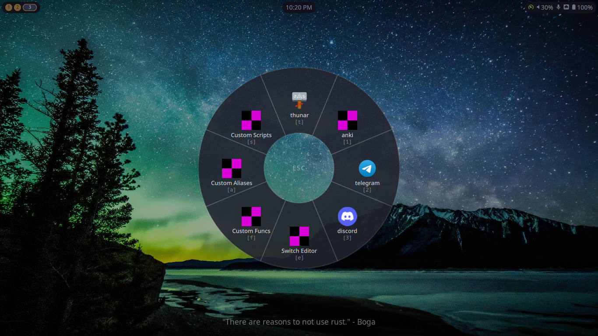

#+title: Wheel Hover Launcher
#+author: hassan24641@gmail.com
#+options: toc:nil

Radial (wheel-style) app launcher for Hyprland, built with Quickshell 0.3.x.

* Features

- Radial menu drawn as annular sectors, opened with a single keybind.
- Homerow keyboard launching: sectors are labelled ~a s d f g h j k l ;~ by
  default; override per app with ~apps.json~ ~"key"~.
- Mouse support: hover to highlight, ~Ctrl~/~Alt~ + left click to launch.
- Optional Ctrl/Alt hover-to-launch (dwell, default 250ms; plain hover never launches).
- Idle auto-close after N ms without a key press.
- User-editable app list in ~~/.config/wheel-hover-launcher/apps.json~, hot-reloaded on save.
- Per-app icon from the XDG icon theme, with a first-letter fallback.

* Tech stack

| Component  | Choice                                    |
|------------+-------------------------------------------|
| Compositor | Hyprland (Lua config)                     |
| Shell      | Quickshell 0.3.x (QML / Qt 6)             |
| Language   | QML (declarative, no build step)          |
| Config     | JSON (~apps.json~)                        |
| Layer      | Wayland ~wlr-layer-shell~ (overlay layer) |

* Setup

1. Install Quickshell (~pacman -S quickshell~).

2. Start the shell once per login. In ~~/.config/hypr/hyprland.lua~, inside
   the ~hl.on("hyprland.start", function() ... end)~ block:

   #+begin_src lua
   hl.exec_cmd("quickshell -p /home/dt/dev/wheel-hover-laucher")
   #+end_src

   The window is created hidden, so nothing is visible until you invoke it.

3. Bind the shortcut (in ~hyprland.lua~):

   #+begin_src lua
   hl.bind(mainMod .. " + X", hl.dsp.global("quickshell:wheel-hover-launcher"))
   #+end_src

   The QML registers ~appid=quickshell~, ~name=wheel-hover-launcher~ over
   ~hyprland_global_shortcuts_v1~. Verify with:

   #+begin_src sh
   hyprctl globalshortcuts
   # quickshell:wheel-hover-launcher -> Toggle the wheel app launcher
   #+end_src

   If your Hyprland lists a different identifier, use exactly what it prints.
   On a classic ~hyprland.conf~ the equivalent is
   ~bind = SUPER, X, global, quickshell:wheel-hover-launcher~.

4. Reload Hyprland (~hyprctl reload~) or re-login.

* Usage

Sectors show a homerow key (~a s d f g h j k l ;~) or the per-app ~key~
from ~apps.json~ when set (see Configuration).

| Action                       | Result                         |
|------------------------------+--------------------------------|
| ~Super+X~                    | Toggle the wheel               |
| Homerow or custom ~key~     | Launch that sector's app      |
| Hover a sector               | Highlight only (no launch)    |
| ~Ctrl~/~Alt~ + hover ≥ ~hoverDelay~ ms | Launch after dwell |
| Release ~Ctrl~/~Alt~ during dwell | Cancels pending auto-launch |
| ~Ctrl~/~Alt~ + left click    | Launch the highlighted app     |
| ~Esc~                        | Close                          |
| Click blank area / center    | Close                          |
| Idle ≥ ~idleTimeout~ ms      | Close                          |
| Plain left click on a sector | Nothing (no accidental launch) |

The idle timer only counts *key presses* (and opening the wheel). Mouse
movement and hovering do not keep it alive, so the wheel closes on its own if
you do not type. Apps beyond the 10 homerow keys are mouse-only.

Hover dwell is *always on* while Ctrl/Alt is held (no ~autoLaunch~ flag —
plain hover never launches). The timer restarts when the sector under the
cursor changes, so sweeping the mouse across the wheel never launches
anything; only a steady hover with the modifier held reaches ~hoverDelay~
(default 250ms). Releasing the modifier cancels a pending launch.

* Configuration — apps.json

Location: ~~/.config/wheel-hover-launcher/apps.json~
example apps.json could be like
#+begin_src json
  {
  "hoverDelay": 250,
  "idleTimeout": 5000,
  "apps": [
  { "name": "thunar", "icon": "org.xfce.thunar", "exec": "thunar ~", "key": "t" },
  { "name": "anki", "icon": "", "exec": "kitty bash -c '/home/dt/anki-launcher-25.09-linux/anki'", "key": "1" },
  { "name": "telegram", "icon": "org.telegram.desktop", "exec": "Telegram", "key": "2" },
  { "name": "discord", "icon": "discord", "exec": "discord", "key": "3" },
  { "name": "Switch Editor", "icon": "", "exec": "kitty bash -c 'source ~/.bashrc-functions && editor-switcher'", "key": "e" },
  { "name": "Custom Funcs", "icon": "", "exec": "kitty bash -c 'source ~/.bashrc-functions && fuzzy_function'", "key": "f" },
  { "name": "Custom Aliases", "icon": "", "exec": "kitty bash -c 'source ~/.bashrc-functions && source ~/.bashrc-aliases && fuzzy_alias'", "key": "a" },
  { "name": "Custom Scripts", "icon": "", "exec": "kitty bash -c 'source ~/.bashrc-functions && scriptsRun'", "key": "s" }
  ]
  }

#+end_src

| Field         | Meaning                                                                    |
|---------------+----------------------------------------------------------------------------|
| ~hoverDelay~  | Ctrl/Alt dwell threshold in ms (default 250).                              |
| ~idleTimeout~ | Close after this many ms without a key press (default 5000).               |
| ~apps[].name~ | Label drawn under the icon.                                                |
| ~apps[].icon~ | An XDG icon *theme name*. If missing, the first letter of ~name~ is drawn. |
| ~apps[].exec~ | Shell command, launched as ~setsid -f <exec>~ (fully detached).            |
| ~apps[].key~  | Optional single-char launch key (e.g. ~"t"~). Case-insensitive.            |

Key resolution (see ~KeyMap.js~):

1. A non-empty ~key~ claims that character (first app wins on duplicates).
2. Apps with no/empty ~key~ fall back to the positional homerow slot
   (~a s d f g h j k l ;~ by index) *only if unclaimed*; otherwise that
   sector is mouse-only.

Notes:

- The file is watched: edits are picked up live, no restart needed.
- JSON has *no comment syntax*. Lines starting with ~//~ make the whole file
  invalid and the wheel renders empty (see [[file:bugs.org][bugs.org]]).
- Icon names must match the theme. Use the name from the app's ~.desktop~ file
  (e.g. ~org.telegram.desktop~, ~org.xfce.thunar~). Wrong names fall back to a
  letter.
- To run a *bash function* (not a binary), wrap it in a terminal and source
  your functions file, e.g.:
  #+begin_src json
  { "name": "Switch Editor", "icon": "emacs",
    "exec": "kitty bash -c 'source ~/.bashrc-functions && editor-switcher'" }
  #+end_src

* How it works (short version)

- ~PanelWindow~ on the Wayland ~overlay~ layer, fullscreen, transparent,
  ~exclusiveZone: -1~, ~keyboardFocus: Exclusive~ (for ~Esc~).
- Sectors are painted by a single ~Canvas~ (annular pie slices).
- Hit detection is pure polar math: distance from center selects the ring,
  ~atan2(dy, dx)~ selects the sector.
- Icons / labels / key hints are ~Repeater~ delegates placed at polar
  coordinates.
- Keyboard: the focus item forwards ~Keys.onPressed~; homerow keys map to
  sectors and any key press resets the idle timer.
- ~FileView~ reads ~apps.json~ (~text()~ is a function, not a property);
  ~blockLoading: true~ makes the config ready before the window loads.
- ~GlobalShortcut~ (from ~Quickshell.Hyprland~) toggles window visibility.

* Troubleshooting

- Shortcut does nothing: check ~hyprctl globalshortcuts~ and that only one
  quickshell instance is running (~pgrep -a quickshell~).
- Bad config: the launcher logs ~wheel-hover-launcher: bad apps.json~ and shows an
  empty wheel; validate with ~python3 -m json.tool apps.json~.
- Cannot test the keybind with ~wtype~: Hyprland ignores virtual-keyboard
  events for binds. Dispatch directly instead:
  #+begin_src sh
  hyprctl dispatch 'hl.dsp.global("quickshell:wheel-hover-launcher")'
  #+end_src
- Logs: ~/run/user/$UID/quickshell/by-id/*/log.qslog~.

* Project structure

#+begin_example
~/dev/wheel-hover-laucher/
├── shell.qml           # window, config loading, global shortcut, key handling
├── Wheel.qml           # radial menu: sectors, polar hit detection, timers
├── KeyMap.js           # pure custom/homerow key resolution (unit-tested)
├── tests/
│   └── keymap.test.js  # node tests for KeyMap.js
├── README.org          # this file
├── plans-and-todos.org # build plan / task tracking
├── bugs.org            # known bugs + fixes
├── changelog.org       # project history
├── LICENSE             # GPL-3.0
└── .gitignore

~/.config/wheel-hover-launcher/apps.json   # user app list (outside the repo)
~/magnus/wheel-hover-launcher/logs/        # debug logs (when implemented)
#+end_example
